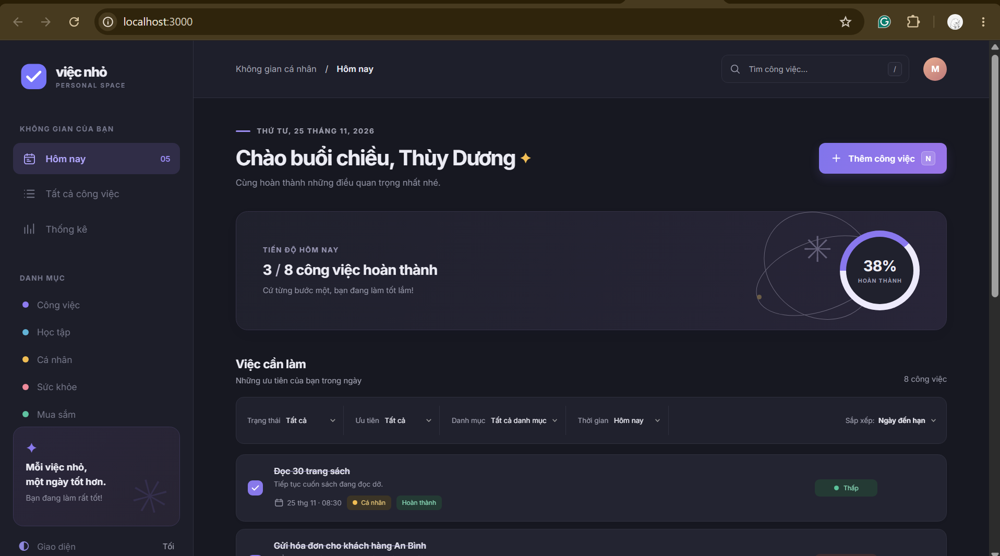
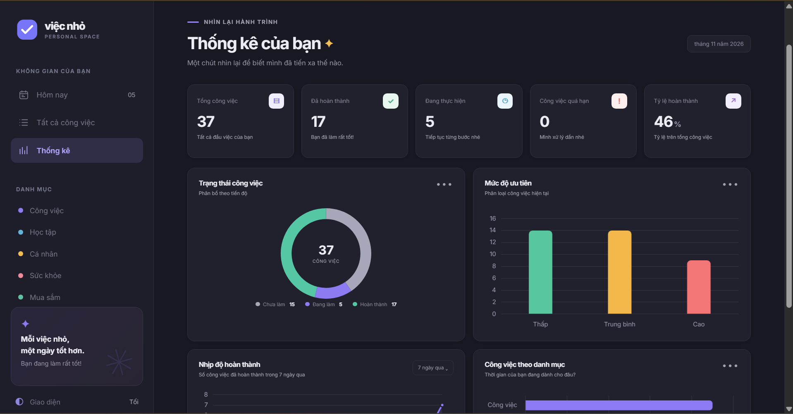
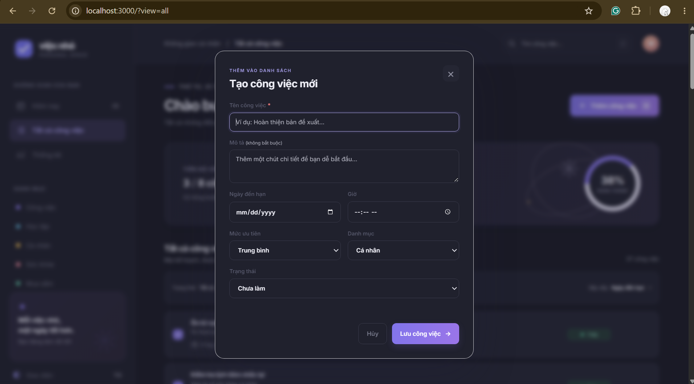

# Việc Nhỏ — Quản lý công việc cá nhân

Việc Nhỏ là ứng dụng TODO cá nhân bằng tiếng Việt, giúp bạn sắp xếp công việc, ưu tiên điều quan trọng và nhìn lại tiến độ mỗi ngày.

## Tính năng

- Màn hình Hôm nay có công việc đến hạn, việc quá hạn và tiến độ hoàn thành.
- Tìm kiếm tức thời theo tiêu đề/mô tả; lọc trạng thái, ưu tiên, danh mục và thời gian.
- Tạo, chỉnh sửa, xóa (có hoàn tác trong 5 giây) và hoàn thành nhanh công việc.
- Trang Thống kê với KPI và biểu đồ trạng thái, ưu tiên, nhịp độ hoàn thành, danh mục.
- Giao diện sáng/tối, thiết kế responsive, hỗ trợ bàn phím và giảm chuyển động.
- Tự tạo cơ sở dữ liệu và dữ liệu mẫu khi khởi chạy lần đầu.

## Giao diện



Màn hình Hôm nay giúp bạn theo dõi các công việc cần ưu tiên và tiến độ trong ngày.



Trang Thống kê tổng hợp tiến độ, mức độ ưu tiên và công việc theo danh mục.



Biểu mẫu thêm công việc cho phép nhập hạn chót, mức ưu tiên, danh mục và trạng thái.

## Công nghệ

- Node.js 18+, Express
- SQLite qua `better-sqlite3`
- HTML, CSS và JavaScript ES modules (không cần bước build)
- Chart.js từ jsDelivr, Inter từ Google Fonts

## Cấu trúc thư mục

```text
todo-app/
├── data/                 # Cơ sở dữ liệu SQLite (tự tạo, không đưa vào Git)
├── public/
│   ├── css/styles.css
│   ├── js/{app,api,ui,stats}.js
│   └── index.html
├── src/
│   ├── db.js
│   ├── seed.js
│   └── routes/{tasks,stats}.js
├── package.json
└── server.js
```

## Cơ sở dữ liệu

Bảng `tasks` gồm: `id`, `title`, `description`, `due_date`, `due_time`, `priority`, `category`, `status`, `completed_at`, `created_at`, `updated_at`. Mức ưu tiên hợp lệ: `low`, `medium`, `high`; trạng thái: `todo`, `doing`, `done`. Có chỉ mục cho `due_date` và `status`. Tệp SQLite được lưu tại `data/todo.db`.

## API

| Phương thức | Đường dẫn | Mô tả |
|---|---|---|
| GET | `/api/tasks?scope=today\|all&q=&status=&priority=&category=&from=&to=&sort=` | Danh sách, tìm kiếm, lọc và sắp xếp |
| GET | `/api/tasks/:id` | Chi tiết công việc |
| POST | `/api/tasks` | Tạo công việc |
| PUT | `/api/tasks/:id` | Cập nhật công việc |
| PATCH | `/api/tasks/:id/toggle` | Chuyển trạng thái hoàn thành/chưa làm |
| DELETE | `/api/tasks/:id` | Xóa công việc |
| GET | `/api/stats` | Tổng hợp số liệu và dữ liệu biểu đồ |

Lỗi API trả JSON theo dạng `{ "error": "..." }`.

## Cài đặt và chạy

Cần cài Node.js phiên bản 18 trở lên.

```bash
npm install
npm run seed       # Tùy chọn: xóa dữ liệu hiện có và nạp khoảng 40 công việc mẫu
npm start
```

Mở [http://localhost:3000](http://localhost:3000). Nếu chưa chạy lệnh seed, ứng dụng sẽ tự thêm dữ liệu mẫu khi cơ sở dữ liệu còn trống. Có thể đổi cổng bằng biến môi trường `PORT`.

Chế độ phát triển tự khởi động lại máy chủ:

```bash
npm run dev
```

## Phím tắt

- `/`: chuyển con trỏ vào ô tìm kiếm.
- `N`: mở biểu mẫu tạo công việc mới.
- `Esc`: đóng hộp thoại đang mở.
- `Enter`: gửi biểu mẫu khi đang ở trong biểu mẫu.

## Quy trình tạo bằng AI (Codex/VibeCoding)

Ứng dụng được khởi tạo và hoàn thiện từ một AI prompt mô tả yêu cầu sản phẩm, giao diện, API và tiêu chí nghiệm thu; mã nguồn được tổ chức thành các mô-đun nhỏ và kiểm tra bằng cách chạy ứng dụng cùng các API.

## Prompt đã dùng (VibeCoding với Codex)

Quy trình bắt đầu bằng việc mô tả đầy đủ stack công nghệ, tính năng, thiết kế, API và tiêu chí nghiệm thu. Prompt gốc được giữ lại bên dưới để tiện tham khảo và tái sử dụng.

```text
You are a senior full-stack engineer and UI/UX designer. Build a complete, polished, runnable personal TODO / task-management web app in the current empty folder.

## TECH STACK (strict)
- Backend: Node.js (>=18) + Express
- Database: SQLite using the `better-sqlite3` package (file: ./data/todo.db, auto-created on first run)
- Frontend: plain HTML + CSS + vanilla JavaScript (ES modules), served statically by Express from ./public. No build step.
- Charts: Chart.js loaded from CDN (jsdelivr)
- Icons: Lucide or inline SVG; Font: Inter from Google Fonts
- UI language: Vietnamese

## CORE FEATURES
1. **Today view (default page)**: show tasks whose due date is today, plus overdue tasks that are not done (marked with an "Quá hạn" badge). Show a greeting, today's date, and a progress ring (completed / total today).
2. **Search**: realtime search by title/description (debounced 250ms).
3. **Filter & sort**: filter by status (Tất cả / Chưa làm / Đang làm / Hoàn thành), priority (Thấp / Trung bình / Cao), category, and date range (Hôm nay / 7 ngày / Tháng này / Tất cả). Sort by due date, priority, or created time.
4. **CRUD**:
   - Create task via a modal form: title (required), description, due date, due time, priority, category, status.
   - Edit task in the same modal.
   - Delete with a confirmation dialog and an undo toast (5s).
   - Quick-complete: clicking a checkbox toggles done with an animation.
5. **Statistics page** (`/stats` as a tab/section, no page reload):
   - KPI cards: total tasks, completed, in progress, overdue, completion rate %.
   - Doughnut chart: tasks by status.
   - Bar chart: tasks by priority.
   - Line/bar chart: tasks completed per day for the last 7 days.
   - Horizontal bar: tasks by category.
6. **Mock data**: a seed script (`npm run seed`) that clears and inserts ~40 realistic Vietnamese tasks spread over the last 14 days and next 7 days, with varied priorities, categories (Công việc, Học tập, Cá nhân, Sức khỏe, Mua sắm), and statuses. Also auto-seed if the DB is empty on first start.

## DATABASE SCHEMA
Table `tasks`:
- id INTEGER PRIMARY KEY AUTOINCREMENT
- title TEXT NOT NULL
- description TEXT DEFAULT ''
- due_date TEXT (YYYY-MM-DD)
- due_time TEXT (HH:mm, nullable)
- priority TEXT CHECK IN ('low','medium','high') DEFAULT 'medium'
- category TEXT DEFAULT 'Cá nhân'
- status TEXT CHECK IN ('todo','doing','done') DEFAULT 'todo'
- completed_at TEXT (nullable ISO datetime)
- created_at TEXT DEFAULT CURRENT_TIMESTAMP
- updated_at TEXT DEFAULT CURRENT_TIMESTAMP
Add indexes on due_date and status. Use prepared statements everywhere (no SQL injection).

## REST API
- GET /api/tasks?scope=today|all&q=&status=&priority=&category=&from=&to=&sort=
- GET /api/tasks/:id
- POST /api/tasks
- PUT /api/tasks/:id
- PATCH /api/tasks/:id/toggle  (todo/doing -> done, done -> todo; set/clear completed_at)
- DELETE /api/tasks/:id
- GET /api/stats  (returns totals, byStatus, byPriority, byCategory, last7DaysCompleted, overdueCount, completionRate)
Validate input, return proper HTTP status codes and JSON error messages `{ "error": "..." }`. Add a global error handler.

## UI / UX DESIGN REQUIREMENTS
- Modern, professional, attractive SaaS-dashboard look: left sidebar (logo, nav: Hôm nay, Tất cả công việc, Thống kê), top bar with search, main content area. Fully responsive (sidebar collapses to a bottom/tab bar or hamburger on mobile).
- Design system with CSS variables: soft gradient accent (indigo -> violet), rounded corners (14-18px), subtle shadows, glassmorphism on cards/modal, generous spacing.
- Light and dark theme with a toggle (persist in localStorage, respect prefers-color-scheme).
- Priority color chips (green/amber/red), status chips, category tags with colors.
- **Animations & micro-interactions** (CSS transitions/keyframes, no heavy libraries):
  - Page/tab transitions with fade + slide.
  - Task cards stagger-in on load; smooth add/remove (height + opacity) transitions.
  - Animated checkbox with check-mark draw and strike-through of the title; small confetti burst when completing a task.
  - Animated progress ring and count-up numbers on KPI cards.
  - Modal scale/blur-in; button hover/press effects; toast notifications sliding in.
  - Skeleton loaders while fetching; friendly empty-state illustration (inline SVG) with a call-to-action.
  - Respect `prefers-reduced-motion`.
- Accessibility: semantic HTML, labels, focus-visible styles, keyboard support (Esc closes modal, Enter submits, `/` focuses search, `N` opens new-task modal).

## PROJECT STRUCTURE
todo-app/
  package.json  (scripts: start, dev [node --watch], seed)
  server.js
  src/db.js, src/routes/tasks.js, src/routes/stats.js, src/seed.js
  public/index.html, public/css/styles.css, public/js/app.js, api.js, ui.js, stats.js
  data/ (gitignored, keep .gitkeep)
  .gitignore (node_modules, data/*.db)
  README.md

## README.md (in Vietnamese, professional)
Include: project title + short intro, feature list, screenshots placeholder section, tech stack, folder structure, database schema, API table, installation & run instructions (`npm install`, `npm run seed`, `npm start`, open http://localhost:3000), keyboard shortcuts, and a short section "Quy trình tạo bằng AI (Codex/VibeCoding)" noting the app was generated with an AI prompt.

## QUALITY BAR / ACCEPTANCE CRITERIA
- `npm install && npm start` works on a fresh machine with zero extra setup; DB file and tables are created automatically.
- No console errors in browser or server. All CRUD, search, filter, and stats work and reflect DB changes immediately.
- Clean, commented, modular code; no hard-coded absolute paths; PORT configurable via env (default 3000).
- After writing the code, run `npm install`, start the server, test each API endpoint with curl, fix any bugs, and finally summarize what you built and how to run it.
```
